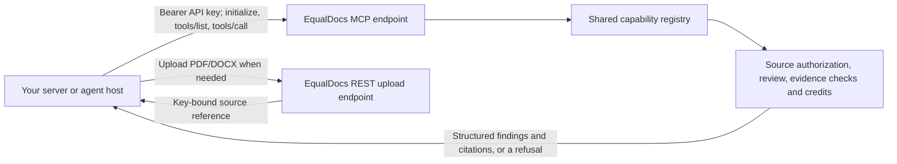

# EqualDocs MCP integration guide

**Status:** Current API guide for third-party developers. Capability availability is environment-dependent; discover it at runtime.

EqualDocs exposes customer-authorized legal and document capabilities through one HTTP JSON-RPC endpoint, `POST /api/portal/mcp`. The same capabilities are available over REST at `/api/portal/agent/v1`; discover their paths with `GET /api/portal/agent/v1/capabilities`. You integrate with a **capability**, not an EqualDocs digital employee: there is no public reviewer roster, agent creation API, or access to internal prompts. Your application owns its conversation, user approvals, and presentation.



## Before you call

1. The EqualDocs customer creates an API key in their account's **Settings → API keys**. The key starts with `eqd_`, is shown only once, and can be revoked there. Keep it on your server; never put it in a browser, prompt, repository, or log. A session token cannot call MCP, and an API key cannot mint another key.
2. Choose the EqualDocs environment the customer is using. The examples below use `https://qa.equaldocs.com`; substitute the environment hostname supplied for your integration. QA availability is not a production-availability promise.
3. Use the same customer's key for all calls involving a review upload. An upload made with another key cannot be read or reviewed, even if both keys belong to the same customer.

Set `EQUALDOCS_API_KEY` securely in your server environment. For the shell examples, set `EQUALDOCS_BASE_URL=https://qa.equaldocs.com` as well. The examples assume both variables are set; do not paste a real key into commands you will share.

## Discover the tools

Send JSON-RPC 2.0 to the MCP URL with `Authorization: Bearer` and JSON headers. You can first call `initialize`:

```sh
curl --fail-with-body -sS "${EQUALDOCS_BASE_URL}/api/portal/mcp" \
  -H "Authorization: Bearer ${EQUALDOCS_API_KEY}" \
  -H 'Content-Type: application/json' -H 'Accept: application/json' \
  -d '{"jsonrpc":"2.0","id":1,"method":"initialize","params":{}}'
```

The server currently reports protocol version `2025-06-18`. Then discover the enabled tools and their `inputSchema`:

```sh
curl --fail-with-body -sS "${EQUALDOCS_BASE_URL}/api/portal/mcp" \
  -H "Authorization: Bearer ${EQUALDOCS_API_KEY}" \
  -H 'Content-Type: application/json' -H 'Accept: application/json' \
  -d '{"jsonrpc":"2.0","id":2,"method":"tools/list","params":{}}'
```

Read `result.tools`. A tool not listed is **not available** in that environment. In particular, only enable your review UI when `review_legal_document` is listed and its description describes a live review, not a QA contract stub. Do not infer availability from this page or hard-code the roster. REST clients can use `GET /api/portal/agent/v1/capabilities` with the same key; it advertises the same enabled capabilities and their REST paths.

The current registry can expose `list_documents`, `get_document`, `search_templates`, `get_credit_balance`, `get_pack_document`, `answer_legal_question`, and `review_legal_document`. The read tools do not spend EC. Legal answers spend EC; a completed live document review currently costs **20 EC**. Charged tools can be disabled independently. Use `get_credit_balance` for the customer's current balance and disclose the review price before asking them to approve a call.

For a free smoke test, call `get_credit_balance`:

```sh
curl --fail-with-body -sS "${EQUALDOCS_BASE_URL}/api/portal/mcp" \
  -H "Authorization: Bearer ${EQUALDOCS_API_KEY}" \
  -H 'Content-Type: application/json' -H 'Accept: application/json' \
  -d '{"jsonrpc":"2.0","id":3,"method":"tools/call","params":{"name":"get_credit_balance","arguments":{"language":"en"}}}'
```

For this read tool, the answer is in `result.content[0].text`. For structured tools, including `review_legal_document`, use `result.structuredContent` and check `result.isError`; the same JSON is also available as text in `result.content[0].text` for older clients. If `language` is omitted, the key owner's account language is used, not English by default.

## Review a customer-provided document

File ingestion is currently a REST operation. Send a PDF or DOCX, no larger than 10 MiB, as multipart field `file`:

```sh
curl --fail-with-body -sS "${EQUALDOCS_BASE_URL}/api/portal/agent/v1/legal-review-uploads" \
  -H "Authorization: Bearer ${EQUALDOCS_API_KEY}" \
  -F 'file=@agreement.docx'
```

A successful `201` response includes an `upload_id`, a ready-to-use `source` object, a version, a digest, and `expires_at`. The source object has this shape:

```json
{"kind":"desk_upload","upload_id":"<upload_id from the upload response>"}
```

Despite the legacy `desk_upload` name, this reference can be used by any authorized third-party integration. Uploads are bound to the exact API key and expire after 24 hours. The server extracts at most 100,000 characters, rejects encrypted or textless files and unsafe structures, and does not offer OCR or an antivirus guarantee. Obtain the customer's consent to send the document and handle their copy according to your own retention policy.

Call the advertised `review_legal_document` tool with the returned source. This example selects the Ontario employment corpus; choose a pack appropriate to the document and question. Currently loadable pack IDs are `employment-on`, `employment-us-ca`, and `lmia`. Check the advertised schema and your use case before selecting one; these packs are not a guarantee of coverage for every question or jurisdiction.

```sh
curl --fail-with-body -sS "${EQUALDOCS_BASE_URL}/api/portal/mcp" \
  -H "Authorization: Bearer ${EQUALDOCS_API_KEY}" \
  -H 'Content-Type: application/json' -H 'Accept: application/json' \
  -d '{"jsonrpc":"2.0","id":4,"method":"tools/call","params":{"name":"review_legal_document","arguments":{"question":"Identify issues in the termination provision under Ontario employment law.","source":{"kind":"desk_upload","upload_id":"<upload_id from the upload response>"},"pack":"employment-on","justification":"sources","idempotency_key":"<unique stable ID for this requested review>","language":"en"}}}'
```

Replace both placeholders. `idempotency_key` is required: generate a unique value for this logical review and reuse it only for an *identical* retry. A changed request under the same key is a conflict. Do not put raw document text or unrelated chat history in `question` (maximum 2,000 characters). `justification` may be `sources` or `full`; neither returns a private reasoning trace. An optional `desk_matter_ref` (maximum 128 characters) is correlation metadata, not permission to read a matter.

For documents already held by EqualDocs, `source` can instead be `{"kind":"proposal","proposal_id":"<id>"}` or `{"kind":"equaldocs_document","document_id":"<id>","version":"<exact version>"}`. The customer must be authorized for the source; a document review uses the named version rather than silently switching to the latest one.

On success, `result.structuredContent` contains `review_id`, `status`, `ready_for_legal_use`, `answer`, `findings`, `citations`, `abstained`, `boundary`, `usage.credits`, `source_version`, and `expires_at`. Each finding has a document citation and legal-corpus citations when supported. A `document_citation` points to `source_version` and a `[start_char, end_char)` span in the canonical extracted text, obtainable from `GET /api/portal/agent/v1/legal-review-uploads/{upload_id}` with the same key. A `legal_citation` gives `pack`, `document`, a span, and a snippet; fetch the cited body with `get_pack_document` (or its REST equivalent) to verify it. Render the answer and its not-legal-advice notice together. `abstained: true` means the system found no support in the selected corpus, **not** that the document is compliant.

When no longer needed, `DELETE /api/portal/agent/v1/legal-review-uploads/{upload_id}` erases the temporary source and associated completed results. Uploads and review results otherwise expire after 24 hours. You can also `GET /api/portal/agent/v1/legal-review-uploads/{upload_id}/file` for an authorized preview of the screened bytes. These upload operations are REST-only; they are not advertised as MCP tools.

## Errors, retries, and limits

- A missing or revoked key gets HTTP `401` before JSON-RPC dispatch. An MCP protocol error (for example, unknown method or tool) is a JSON-RPC `error` object, usually with HTTP `200`.
- A review refusal is a tool result with `result.isError: true` and `result.structuredContent.error` containing `code`, `message`, and `status_code`. Do not treat HTTP `200` as review success. REST uses HTTP status codes for refusals.
- `insufficient_credits` (`402`) does not charge. `source_not_found` (`404`) also covers a missing, expired, foreign, or unauthorized source. `source_version_changed`, `idempotency_conflict`, and `review_in_progress` use `409`.
- An execution failure such as `evidence_invalid` or `model_unavailable` (`503`) is not a legal finding; the review charge is refunded. A failed, compensated execution is terminal for that idempotency key, so start a new logical attempt with a new key. `refund_pending` means compensation is still being retried. Identical retries of a completed request replay its result without another charge.
- A live completed review has `status: "completed"` and `ready_for_legal_use: true`; a QA stub reports `status: "contract_stub"`, `ready_for_legal_use: false`, and no legal conclusion. Never present a stub as a review. The tool is synchronous, without streaming or server-side conversation state, and it cannot edit a document, sign, email, or open a matter.

The current endpoint supports the JSON-RPC `initialize`, `tools/list`, and `tools/call` methods shown above over HTTP POST. Some general-purpose MCP hosts require additional lifecycle or streaming transport behavior; test host compatibility before claiming plug-and-play support. If your host cannot use this transport, use the REST paths returned by `/api/portal/agent/v1/capabilities`. The upload and review REST paths are shown above.
